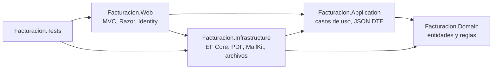
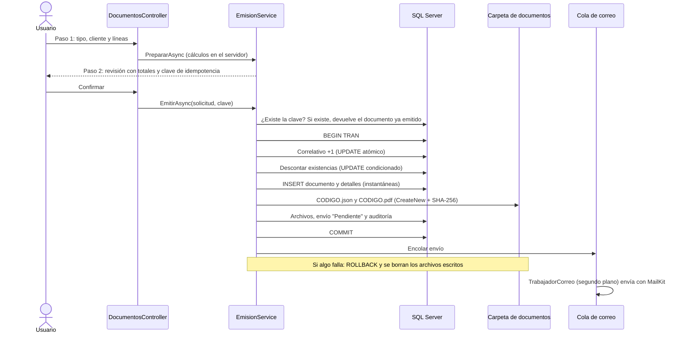
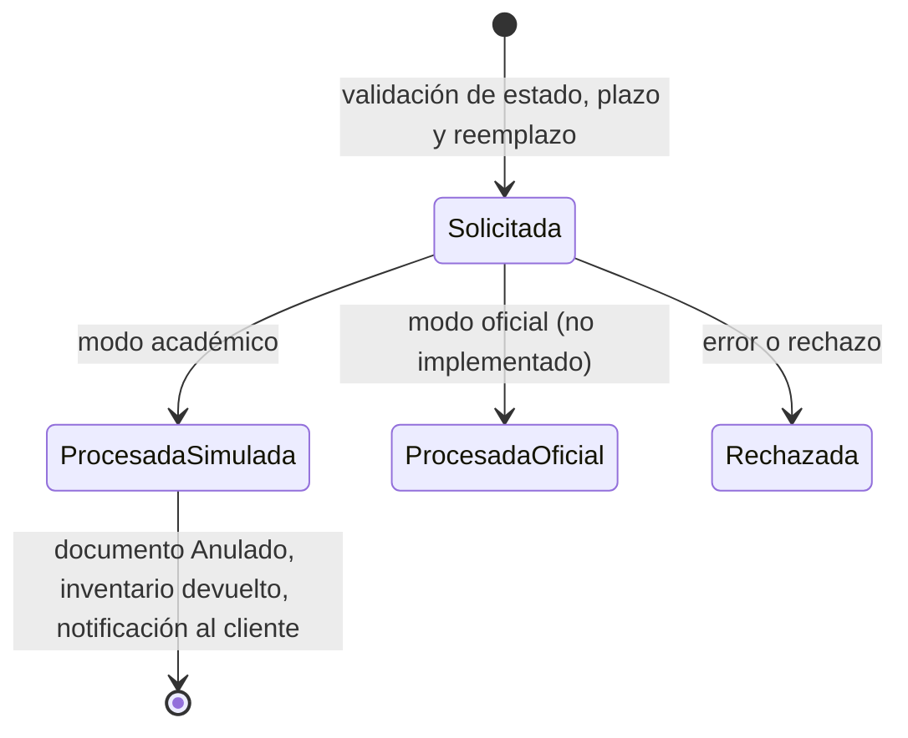

# 1. Arquitectura

## Capas

La solución sigue una arquitectura por capas. Las dependencias apuntan hacia el dominio.

| Capa | Responsabilidad | Ejemplos |
|---|---|---|
| Domain | Reglas sin dependencias externas: se prueban sin base de datos | `CalculadoraImportes`, `ReglasCliente`, `ReglasDocumento`, `ReglasAnulacion`, `NumeroALetras` |
| Application | Orquesta cada caso de uso; depende de interfaces, no de implementaciones | `EmisionService`, `CorreoService`, `AnulacionService`, `RespaldoService`, `GeneradorDteJson` |
| Infrastructure | Implementa las interfaces | `AppDbContext`, `GeneradorPdfQuest`, `EnviadorCorreoMailKit`, `AlmacenArchivosLocal`, `TransmisorAcademico` |
| Web | Presentación, autenticación, autorización y encabezados de seguridad | Controladores, vistas, `Program.cs` |

Interfaces principales (`Application/Abstracciones/Contratos.cs`): `IAppDbContext`, `IReloj`, `IUsuarioActual`,
`IAlmacenArchivos`, `IGeneradorPdf`, `IEnviadorCorreo`, `IColaCorreo`, `ITransmisorHacienda`, `IProveedorRespaldo` e
`IAuditoria`. Gracias a ellas las pruebas sustituyen el correo, el reloj y la base de datos sin tocar el código de negocio.

## Flujo de emisión

Puntos clave:

- **Los importes los calcula siempre el servidor** (`CalculadoraImportes`). El navegador solo muestra un precio orientativo.
- **Idempotencia.** La pantalla de revisión genera una clave `Guid` única. Si el usuario confirma dos veces, recarga la
  página o hay dos peticiones simultáneas, el índice único `ClaveIdempotencia` garantiza un solo documento.
- **Correlativos sin duplicados.** La fila del correlativo del año se crea fuera de la transacción, tolerando la
  carrera, y se incrementa con un `UPDATE` atómico que bloquea la fila hasta el `COMMIT`. Lo verifica una prueba con 8
  emisiones simultáneas en SQL Server.
- **Inventario.** Se descuenta con `UPDATE … WHERE Existencias >= cantidad`; si no alcanza, se revierte todo.
- **Instantáneas.** El documento guarda los datos del receptor, del emisor (`EmisorJson`) y de cada producto tal como
  estaban al emitir. Editar un cliente o un producto no altera documentos anteriores.

## Correo

`TrabajadorCorreo` es un `BackgroundService` que lee una cola en memoria (`Channel<int>`). Al iniciar la aplicación
vuelve a encolar los envíos que quedaron "Pendiente". Antes de enviar, `CorreoService` comprueba que los dos archivos
existan, no estén vacíos y conserven la huella SHA-256 registrada. Los errores de MailKit se traducen a mensajes seguros
sin credenciales ni trazas. "Enviado al servidor SMTP" significa que el servidor aceptó el mensaje, no que el cliente lo
leyó. El reenvío crea un intento nuevo con los mismos archivos y nunca emite otro documento.

## Anulación

La notificación al cliente se registra **solo después** de que la anulación quedó procesada. Un índice único filtrado
(`DocumentoId` donde `Estado <> Rechazada`) impide dos anulaciones vigentes del mismo documento.

## Seguridad

| Medida | Implementación |
|---|---|
| Autenticación | ASP.NET Core Identity; contraseñas con hash PBKDF2; mínimo 10 caracteres con mayúscula, minúscula, dígito y símbolo |
| Autorización | Filtro global que exige sesión; políticas `Personal` (Administrador o Facturador) y `SoloAdministrador` (anulaciones, historial, respaldos, configuración, usuarios) |
| Fuerza bruta | Bloqueo de 15 minutos tras 5 intentos fallidos; límite de 10 intentos de inicio de sesión por minuto por IP (`Seguridad:IntentosInicioSesionPorMinuto`) |
| CSRF | `AutoValidateAntiforgeryToken` global |
| Cookies | `HttpOnly`, `SameSite=Strict`, `Secure` fuera de Development; un usuario desactivado pierde la sesión en menos de un minuto |
| Encabezados | CSP `default-src 'self'` sin estilos ni scripts en línea, `X-Frame-Options: DENY`, `nosniff`, `Referrer-Policy` |
| Errores | Página genérica; el detalle solo va al registro del servidor (Serilog, carpeta `Logs`) |
| Archivos | Carpeta fuera de `wwwroot`, protección contra rutas `..`, sin sobrescritura; descarga solo con sesión iniciada |
| Secretos | Ninguno en el repositorio: User Secrets o variables de entorno |
| Redirecciones | Solo URL locales tras iniciar sesión |
