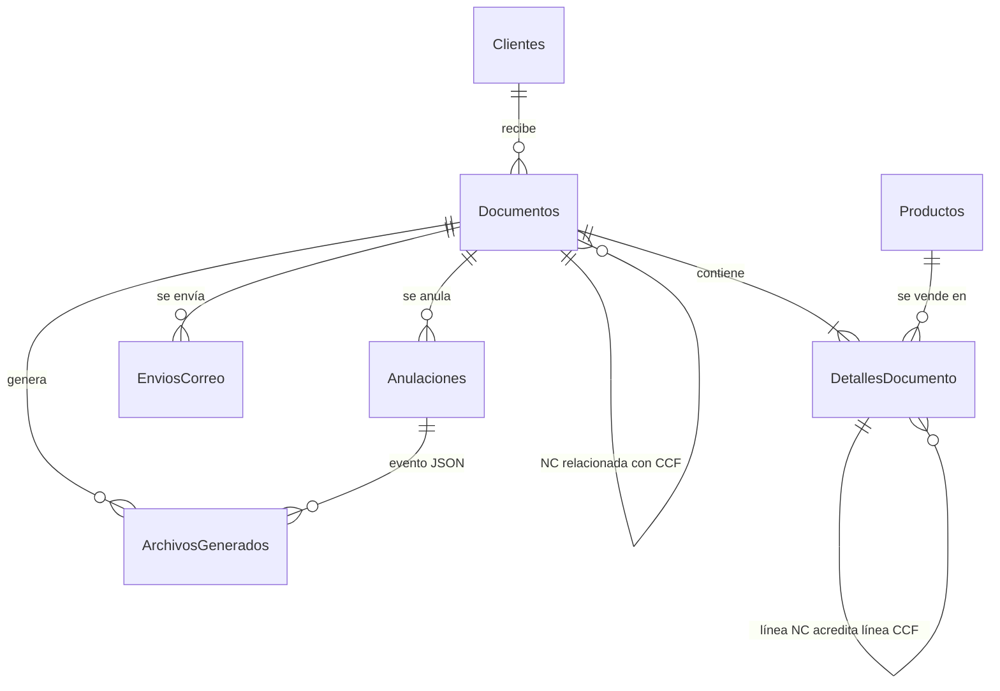

# 2. Modelo de datos

Base de datos SQL Server creada con la migración `Inicial` de EF Core (`src/Facturacion.Infrastructure/Persistencia/Migraciones`).

| Tabla | Contenido | Restricciones importantes |
|---|---|---|
| Clientes | Consumidor final o contribuyente | Único (TipoDocumento, NumeroDocumento) cuando hay documento; `Version` para concurrencia |
| Productos | Código, precio sin IVA, unidad CAT-014, inventario opcional | Código único; `Version` |
| Documentos | Encabezado del DTE con instantáneas del receptor y del emisor, totales y estado | Únicos: CodigoGeneracion, NumeroControl, ClaveIdempotencia |
| DetallesDocumento | Líneas con cantidad, precio, descuento, venta gravada e IVA | Único (DocumentoId, NumItem); se borran en cascada con el documento |
| ArchivosGenerados | Ruta relativa, tamaño, SHA-256 y versión del formato | Ruta única |
| EnviosCorreo | Un registro por intento: motivo, destinatario, estado, error seguro | Único (DocumentoId, NumeroIntento) |
| Anulaciones | Solicitud, responsable, solicitante, resultado | Único DocumentoId filtrado `[Estado] <> 3` (una vigente) |
| Correlativos | Último número por tipo y año | Único (Tipo, Anio) |
| Auditoria | Historial de operaciones | Disparador `TR_Auditoria_SoloInsercion` rechaza UPDATE y DELETE |
| Respaldos | Resultado de cada copia | — |
| ConfiguracionEmisor | Datos del emisor (una fila) | — |
| AspNet* | Usuarios y roles de Identity | — |

- Importes `decimal(18,2)`; cantidades y precios unitarios `decimal(18,4)`. Nunca `float`.
- Ninguna eliminación en cascada salvo detalles: los documentos emitidos no se borran.
- Fechas en UTC (`EmitidoUtc`) más fecha y hora local de El Salvador (`FechaEmision`, `HoraEmision`) para el DTE.
