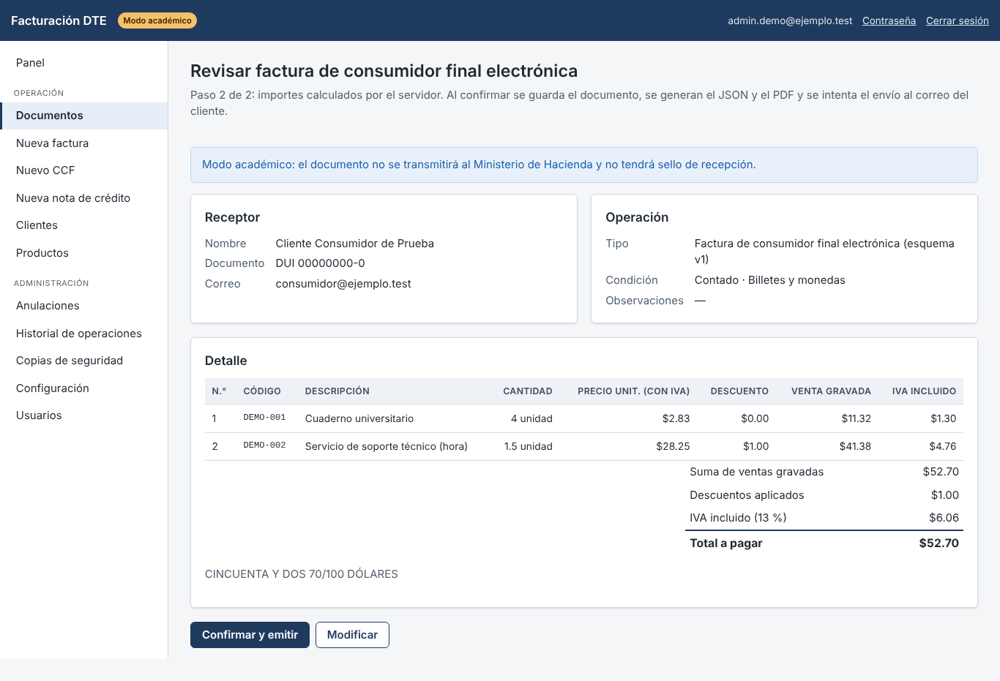
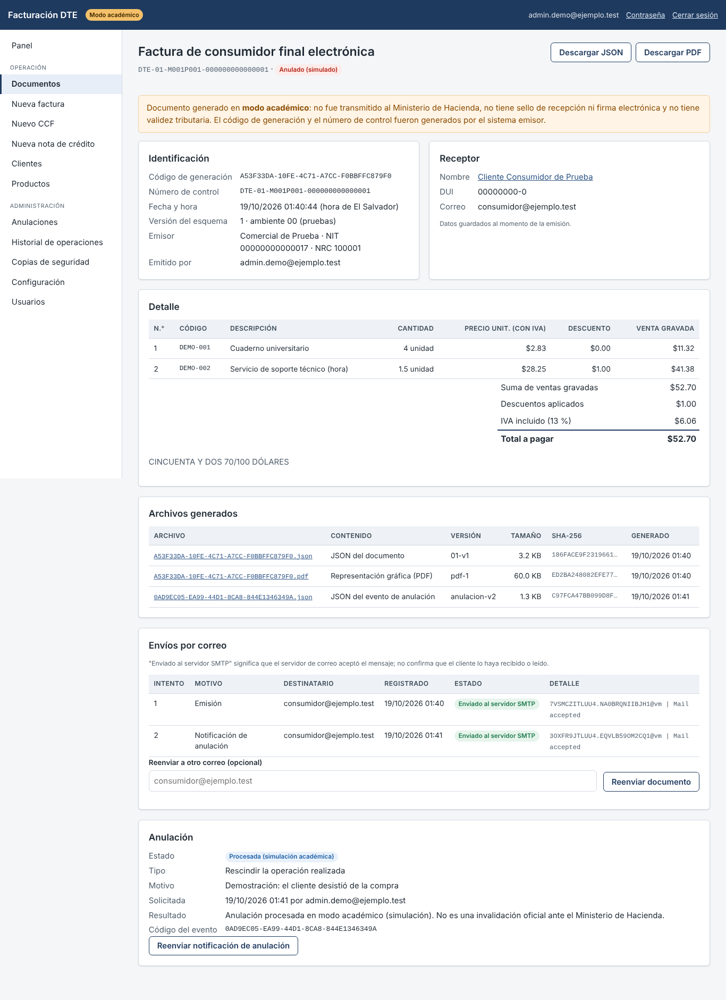
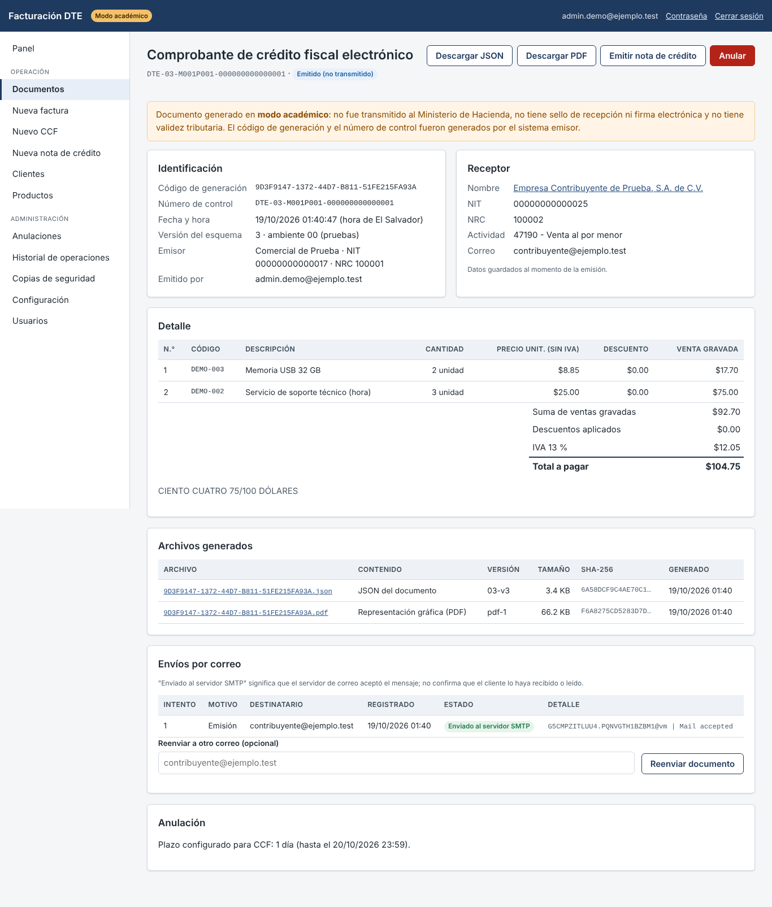
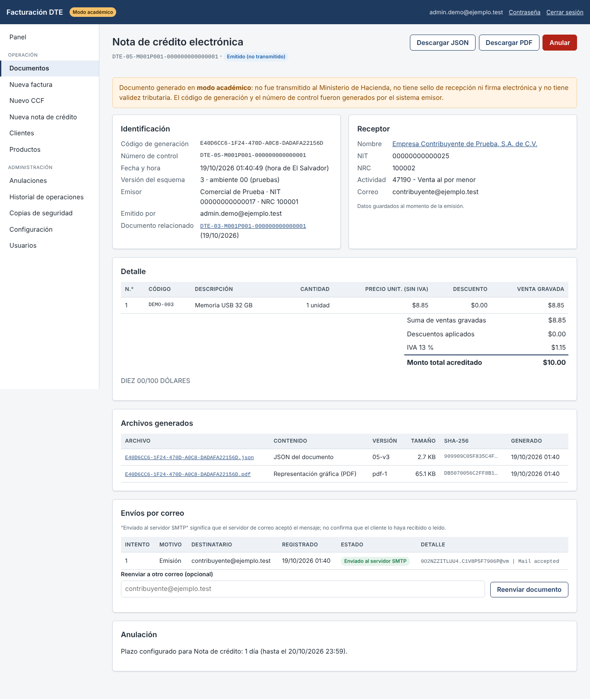
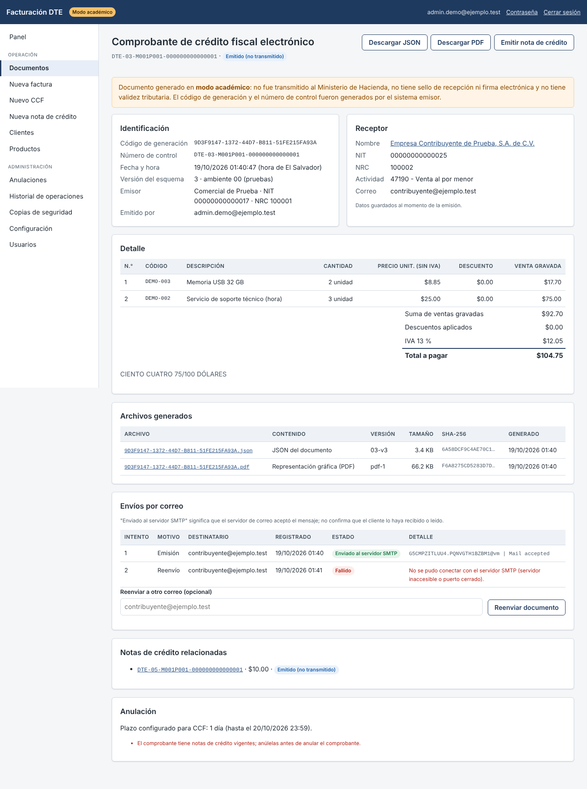
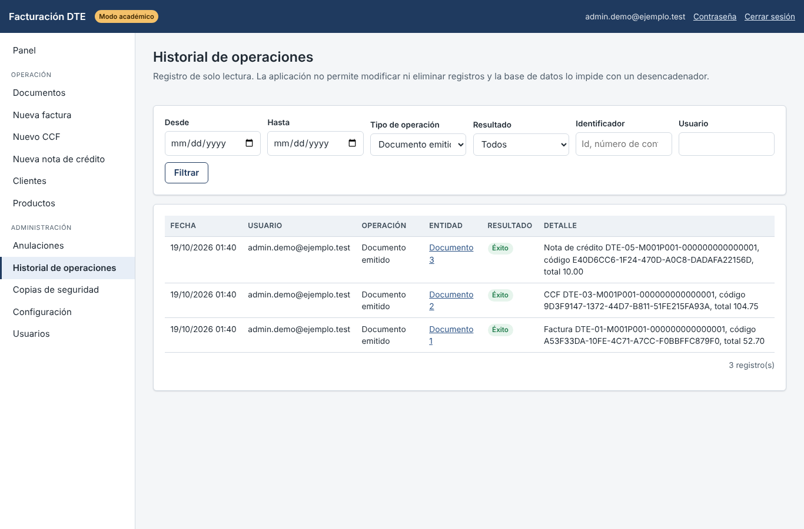
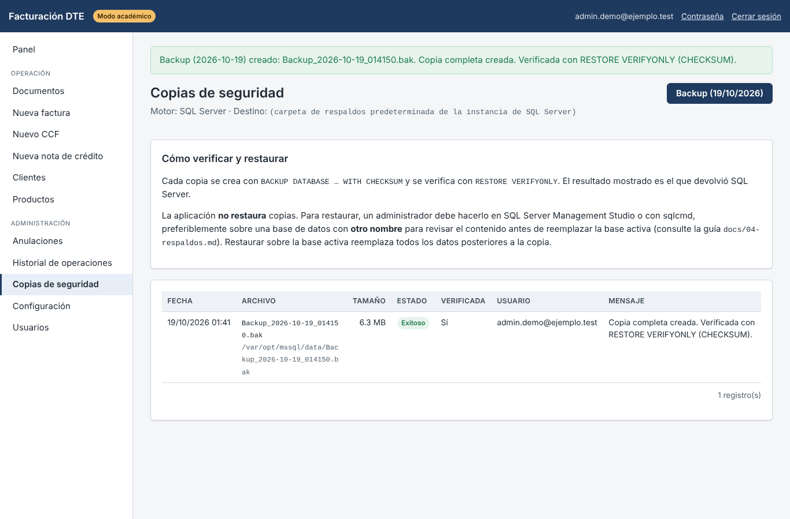
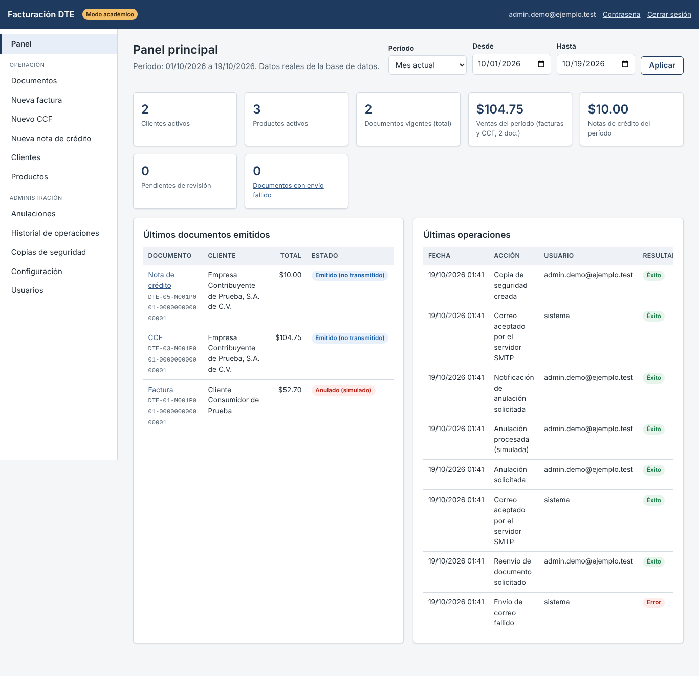
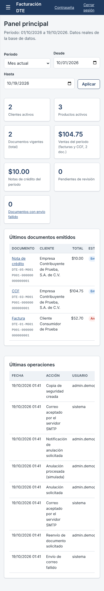

# 7. Guía de demostración (escenarios A–F)

Preparación: iniciar sesión como administrador, completar **Configuración**, crear un cliente consumidor final con
correo, un cliente contribuyente y dos o tres productos (uno con inventario). Use datos inventados.

| Escenario | Pasos | Resultado esperado |
|---|---|---|
| A. Factura | Nueva factura → cliente consumidor final → productos → Revisar cálculos → Confirmar y emitir | Documento con número `DTE-01-…`, JSON y PDF descargables, envío "Enviado al servidor SMTP" |
| B. CCF | Nuevo CCF → cliente contribuyente → Revisar → Confirmar | IVA 13 % sumado; un consumidor final no aparece como receptor |
| C. Nota de crédito | Nueva nota de crédito → elegir CCF → cantidades → Revisar → Confirmar | `documentoRelacionado` con el código del CCF; no permite acreditar más de lo disponible |
| D. Anulación | Detalle de la factura → Anular → tipo "Rescindir", motivo y responsables | Estado "Anulado (simulado)", inventario devuelto, notificación enviada; una segunda anulación se rechaza |
| E. Historial | Historial de operaciones → filtrar por "Documento emitido" o por usuario | Solo las operaciones filtradas; no hay opción de editar ni borrar |
| F. Backup | Copias de seguridad → Backup (fecha) | Fila "Exitoso", verificada con RESTORE VERIFYONLY |

Extra: detener el servidor SMTP y pulsar **Reenviar documento** muestra un intento "Fallido" con el motivo; al
reactivarlo, otro reenvío se acepta sin emitir un documento nuevo. Un usuario Facturador que abre Copias de seguridad
ve "Acceso denegado".

## Capturas (datos sintéticos)

| | |
|---|---|
| Revisión de factura  | Factura anulada con archivos y envíos  |
| CCF  | Nota de crédito  |
| Envío fallido y reenvío  | Historial filtrado  |
| Copias de seguridad  | Panel  |
| Panel en el teléfono  | |
